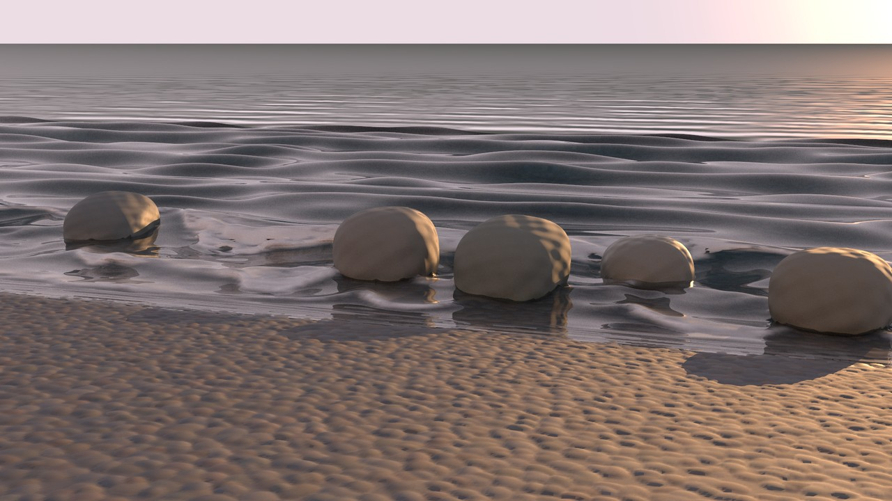

# breaking-wave

A three-dimensional, incompressible, free-surface Navier–Stokes solver with a wave shoal, plunge, run up a gravel beach around boulders and drain back through the stones. Uses NVIDIA Warp, tested on commodity gpu of 5080 class, with aMitsuba rendering path. Substack post: 
[**One Shore, Multiple Representations**](https://vladyslavprytula.substack.com/p/one-shore-multiple-representations

[](media/third-capture-0-6p8s-25fps.mp4)

| Capture | Video | Scene |
| --- | --- | --- |
| Third (accepted 2026-10-22) | [`media/third-capture-0-6p8s-25fps.mp4`](media/third-capture-0-6p8s-25fps.mp4) | Plunging spectrum on the grain-derived gravel bed; three plunges at 1.3, 3.9 and 6.2 s |
| First (accepted 2026-10-13) | [`media/first-capture-0-6p8s-25fps.mp4`](media/first-capture-0-6p8s-25fps.mp4) | Same spectrum on the earlier slip-length bed with a tuned porous layer |

Both are 1920 × 1080, 25 fps, 6.8 simulated seconds on a 384 × 224 × 96 grid
of 12.5 × 26.8 × 10 mm cells, rendered at 512 samples per pixel. Neither is a
loop. Their run configurations, full metric ledgers and one lossless frame
each are in [`media/`](media/); [`docs/results.md`](docs/results.md) says what
was measured and what is still open.

## The contract

> Gravity-wave propagation, momentum transport, shoaling, refraction, run-up,
> wetting/drying, overturning, reconnection and the flow around the boulders
> are resolved. Breaking turbulence, foam, unresolved capillary structure,
> sub-cell films and optical wetness are closures.

no fake cgi to the extent possible: no painted foam, no prescribed breaker collapse, no silent
repair of mass, pressure or energy. Every closure is named, measurable and
switchable, and switching it off reveals the phenomenon it owns.

## What

- **Equations.** One-phase incompressible Navier–Stokes for the water; the air
  is not solved. A water fraction α ∈ [0, 1] per cell is transported
  conservatively (volume of fluid), so the surface can fold, split and merge
  without any special event.
- **Grid.** Uniform staggered MAC grid with analytic cut cells: the beach plane
  and the superquadric boulders are one analytic scene object from which the
  solver's open fractions and face apertures, the diagnostics and the render
  meshes all derive.
- **Interface.** Piecewise-linear planes per mixed cell (PLIC), height-function
  normals where a column supports them, geometric swept-prism fluxes shared by
  water and momentum.
- **Pressure.** A compatible divergence/gradient pair and a matrix-free
  conjugate-gradient solve with geometric multigrid on the regular grid; on
  thin water a mimetic operator on the retained liquid polyhedra, assembled
  and solved in float64 on the GPU because a millimetre film in a centimetre
  cell is ill-conditioned by ten orders of magnitude in float32.
- **Waves.** Exactly periodic finite-depth components (second-order Stokes on
  the steep ones) imposed and absorbed through a relaxation zone.
- **Closures, all default off.** Molecular and Smagorinsky viscosity as one
  symmetric graph Laplacian; Navier-slip rough-wall stress; contact-line
  regularisation; a finite porous bed with Ergun–Forchheimer drag and
  grain-canopy drag derived from a 3 cm pebble; Young–Laplace surface tension
  through the pressure boundary; passive foam sourced by measured dissipation;
  optical wetness. An energy ledger books every term and a signed numerical
  residual that is never repaired.
- **Presentation.** Marching-cubes and exact PLIC-boundary surfaces, a
  resolvedness measure that decides where one plane per cell can describe the
  water, an aerated composite for the columns where it cannot, and Mitsuba
  rendering with a true dielectric interface and Beer–Lambert absorption along
  the real in-water path.

[`docs/solver.md`](docs/solver.md) derives all of this, in the order a time
step runs, with the gates that each piece passes.

## Layout

| Path | Contents |
| --- | --- |
| `shoreloop/physics3d/` | The 3-D solver: state, operators, transport, projection, closures, diagnostics, the production scene |
| `shoreloop/render/` | Surface extraction, resolvedness-gated aerated composite, Mitsuba water, the offshore join |
| `shoreloop/scene/geometry3d.py` | The analytic beach and boulders shared by solver and renderer |
| `shoreloop/physics/`, `numerics/`, `closures/` | The earlier 2-D shallow-water model; kept because the offshore join renders the far water with it and the ripple closure lives there |
| `shoreloop/config.py`, `precision.py`, `device.py` | Configuration dataclasses, the float32/float64 switch, CUDA start-up |
| `tools/` | The runnable path: gate scenes, the flat-box breaker, and the capture → compose → render pipeline that made the videos |
| `tests/` | Governing-property and regression tests (CUDA required for the 3-D solver) |
| `media/` | The two captures, one lossless frame each, their configurations and metrics |
| `docs/` | `solver.md` (method and verification) and `results.md` (captures, provenance, open items) |

The package is still called `shoreloop`: the project set out to make an
exactly looping clip and gave that up when the breaking regime turned out to
carry memory from one wave to the next. The name stayed; the loop did not.
Docstrings that cite `plan.md`, `docs/decisions.md` or milestone results refer
to the development repository's design history, which is not part of this cut.

## Install and verify

The tested target is a DGX Spark GB10, aarch64 Ubuntu 24.04, with CUDA and
Python 3.12 or newer. The 3-D solver refuses to construct without a CUDA
device; the device-independent geometry, scene and presentation tests run
anywhere. FFmpeg is needed to encode video.

```bash
git clone https://github.com/VladPrytula/breaking-wave.git
cd breaking-wave
uv venv --python 3.12 .venv
uv pip install --python .venv/bin/python -e '.[dev]'

.venv/bin/python -m pytest tests -q
```

The quick suite excludes the named long integrations (`-m integration`).

## Run

```bash
export PYTHONPATH=.:tools

# Solver gates on a small tank: linear-wave, plane-beach, shoaling-wave,
# natural-breaker, one-boulder-wash, boulder-cluster
.venv/bin/python tools/run_wave_tank3d.py --demo natural-breaker --refine --output-dir out/natural_breaker

# A flat closed tank: a dam break, one pushed front, or a dispersively focused group
.venv/bin/python tools/run_flat_box_breaker.py --drive front --out out/flat_front

# The production capture (days on the GPU), then composition and rendering
.venv/bin/python tools/capture_boulder_interaction_sequence.py \
    --output-dir out/capture/sequence --incident aw1103 --bed gravel \
    --grid-scale 2 --end-time 6.8 --capture-start 0 --interval .04 \
    --interface-reconstruction height_function \
    --wave-source-reconstruction plic_rays --wave-source-quadrature 8 \
    --vof-flux-reconstruction swept_prism \
    --render-surface plic_boundary --save-nodal-surface --save-wetness \
    --no-ripples --no-foam --offshore-handoff-x 0 --diagnostic
.venv/bin/python tools/export_scene_geometry.py --run out/capture --out out/capture/geometry.npz
.venv/bin/python tools/compose_aerated_frames.py --run out/capture --geometry out/capture/geometry.npz \
    --times 3.88 --composite nodal_body --out out/capture/composites
.venv/bin/python tools/render_saved_frames.py --run out/capture --out out/capture/renders \
    --mesh out/capture/composites/surface_03_88s_nodal_body.npz --time 3.88 --label t388
```

Long runs belong in a detached `tmux` session with `PYTHONUNBUFFERED=1` and a
log under `out/`; see [`docs/results.md`](docs/results.md) for the exact
commands that produced the captures and the numbers they returned.

## Provenance

This tree is the solver at the third capture's commit
(`0dba9ac2b78d1afd0e3c351b1522c68401f92a92` in the development repository),
with the one-off experiment drivers, the 2-D-only tools and tests, the study
course and the agent instructions removed, and the helpers the production
pipeline needs gathered into `tools/production_render.py`. The solver package
and its tests are otherwise unchanged. The first capture was produced at
`cee4a08a1f4d0300cd6d7bec2acec2079cffcb92`, before the gravel-bed closures.

## License

MIT, see [`LICENSE`](LICENSE).
